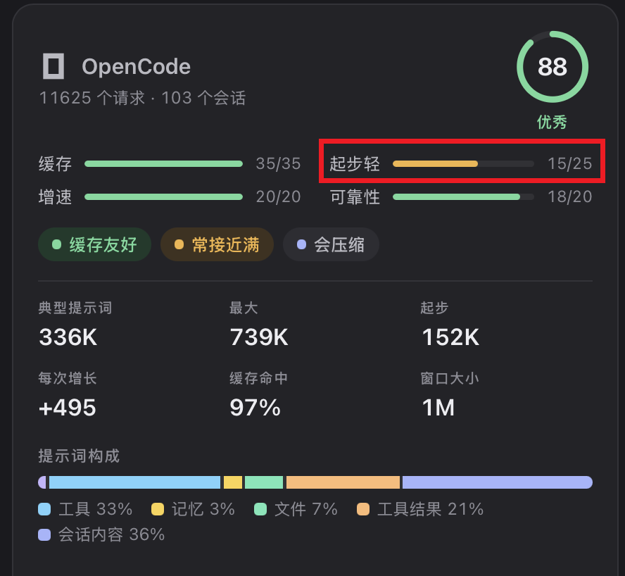
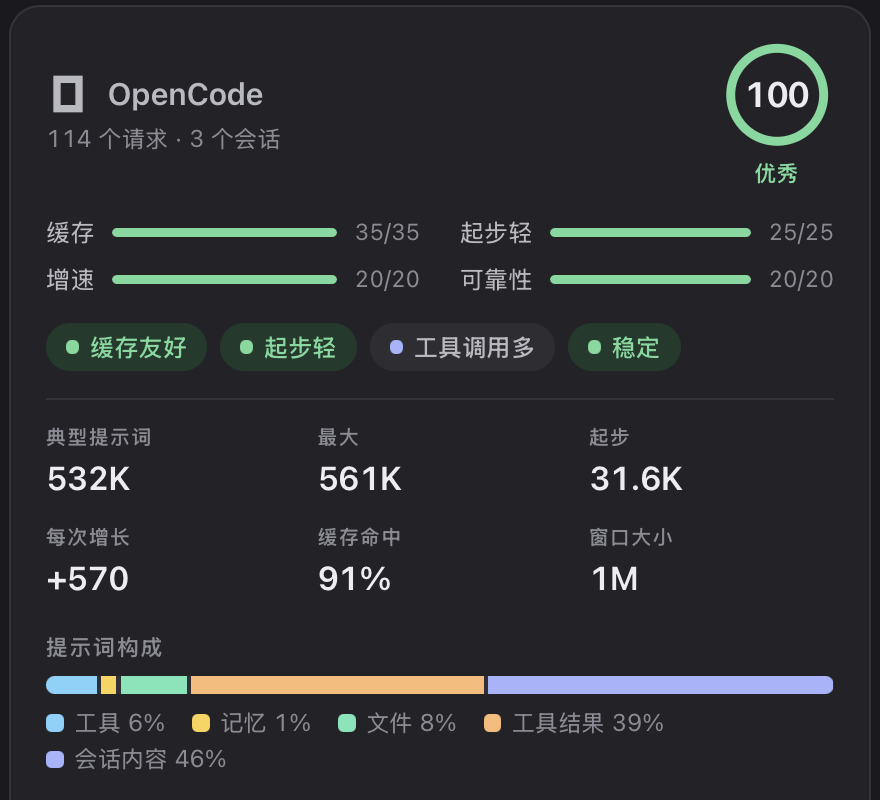
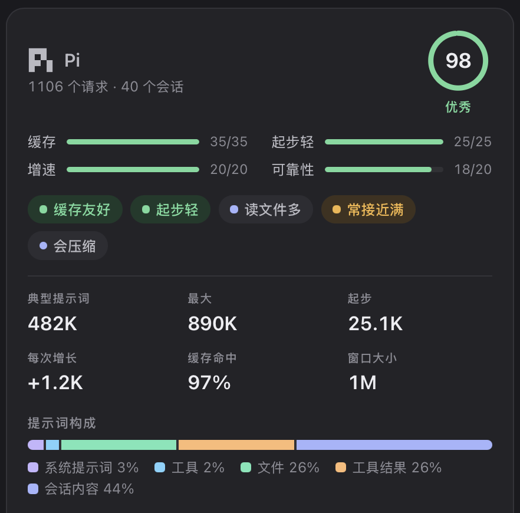

# opencode-slim

**The OpenCode TUI, as lightweight as Pi.**

**English** · [简体中文](README.zh-CN.md)

> This branch is for **OpenCode 1.x**. OpenCode 2 support is planned on the `opencode-2` branch.

## Why

OpenCode has the better TUI, but every session starts heavy. A long, generic system prompt and
a long list of built-in tools are sent with every request before you type a word, and most of
those tools never get called. [Pi](https://pi.dev) starts light, but its TUI and controls are
hard to live with.

This repository keeps OpenCode's TUI and trims the rest toward Pi's weight. It changes
configuration only: no fork, no patched binary, and every change is undone by restoring a file.

## Results

[Magpie](https://github.com/yetone/magpie) scores how much every request starts with, before
the conversation: system prompt, tool definitions, skills, and memory files. The median, on the
same machine:

| | Starts with | Tools share of the prompt |
|---|---|---|
| OpenCode, before | 152K | 33% |
| OpenCode, after | **31.6K** | **6%** |
| Pi | 25.1K | 2% |

<table>
<tr><th>OpenCode before</th><th>OpenCode after</th><th>Pi</th></tr>
<tr>
<td></td>
<td></td>
<td></td>
</tr>
</table>

The "before" figure includes MCP servers that were later made project-only. Measured on a clean
OpenCode 1.19 install with [`scripts/measure.sh`](scripts/measure.sh) and one model, the core
changes cut the first request from 7,094 to 5,091 tokens (−28%). On a real setup the MCP review
saves the most: one Atlassian MCP server alone was about 12,800 tokens per request.

## What changes

| Change | Effect | Needs |
|---|---|---|
| Minimal `build` and `plan` prompts in `~/.config/opencode/agents/` | Replace OpenCode's long default prompt with about 25 lines | — |
| Glob and Grep tools off | Two fewer tool definitions per request; the agent searches with `rg` in bash | [ripgrep](https://github.com/BurntSushi/ripgrep) |
| Lean global `AGENTS.md` | Sent with every request; aim for under 4,000 characters | — |
| MCP review | Every enabled MCP server sends all its tool definitions; keep only daily ones global and enable the rest per project | — |
| Pin OpenCode to 1.x | An upgrade can't jump to OpenCode 2, which breaks 1.x plugins | — |

The plan agent keeps OpenCode's read-only permissions; only its prompt changes.

## Install

Clone the repository and give your agent the runbook:

```sh
git clone https://github.com/yangwudong/opencode-slim
```

Then, in OpenCode (or any coding agent):

```text
Read opencode-slim/SETUP.md and follow it.
```

The agent checks your version, measures your setup, asks which changes to apply, backs up every
file it touches, verifies the result, and reports the tokens saved. To do it by hand, follow
[SETUP.md](SETUP.md) yourself.

## Measure your setup

```sh
scripts/measure.sh                         # default model and agent
scripts/measure.sh -m provider/model -a plan
```

It sends one tiny prompt from an empty temporary repository and prints the first request's input
tokens. Compare runs with the same model only, since tokenizers differ. To see what an MCP server
costs, measure with it disabled:

```sh
OPENCODE_CONFIG_CONTENT='{"mcp":{"<name>":{"enabled":false}}}' scripts/measure.sh
```

## Optional plugins

None of these is required. Measured with `scripts/measure.sh`, none adds more than about 200
tokens per request.

| Plugin | What it does | OpenCode 2 |
|---|---|---|
| [opencode-tps-meter](https://github.com/yangwudong/opencode-tps-meter) | Shows the model's output speed (tokens per second) in the TUI. | Yes |
| [opencode-bark-notify](https://github.com/yangwudong/opencode-bark-notify) | Pushes the agent's replies, questions, and permission requests to your iPhone through the Bark app. | Not yet |
| [opencode-quota](https://github.com/yangwudong/opencode-quota) | Quota and token usage for Copilot, Z.ai, Kimi, OpenCode Go, and more, without polluting the context window. | Use upstream [`@slkiser/opencode-quota`](https://github.com/slkiser/opencode-quota) 5+ |
| [Plannotator](https://github.com/backnotprop/plannotator) | Review and annotate the plan agent's plans before implementation. SETUP.md installs a plan prompt that submits to it. | Yes |
| [cc-safety-net](https://github.com/kenryu42/cc-safety-net) | Blocks destructive shell commands such as `rm -rf` outside the project or `git push --force`. | Yes |
| [opencode-notifier](https://github.com/mohak34/opencode-notifier) | Desktop notifications and sounds when the agent finishes or needs permission. | Yes |

All of them work on OpenCode 1.x. On OpenCode 2 the config moves: plugins go under `plugins`,
and TUI plugins such as tps-meter go in `cli.json`. Each plugin's README has the details.

## Measuring with Magpie

[Magpie](https://github.com/yetone/magpie) routes every coding agent's model through one local
gateway, and its context page shows what each agent's prompts are made of. Its "Lean start"
score compares what every request starts with to the model's context window: full marks at 5% or
less, none at 30%. With a 1M window, 31.6K scores full marks; the same 31.6K against a 200K window
scores about half.

## License

[MIT](LICENSE)
