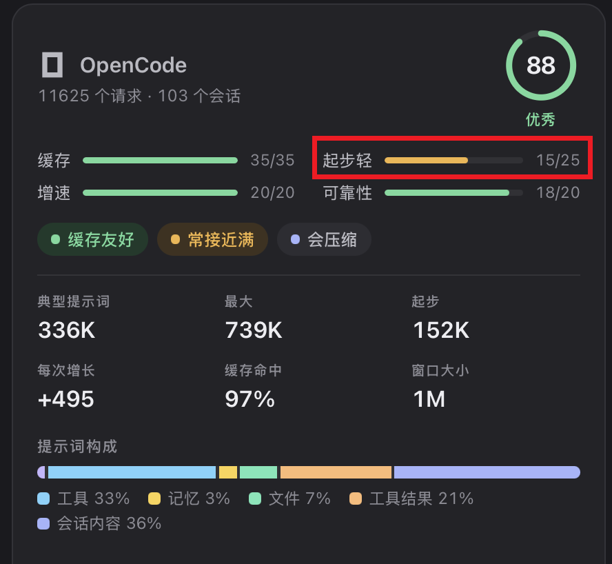
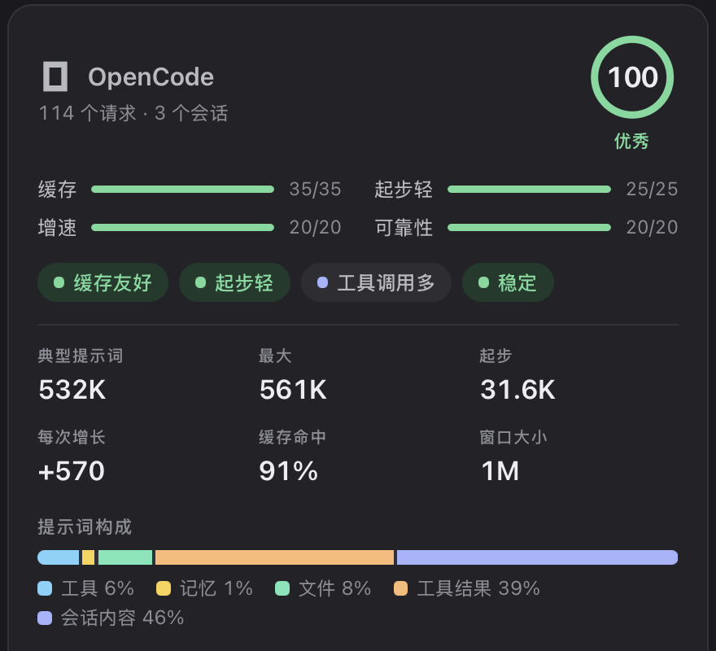
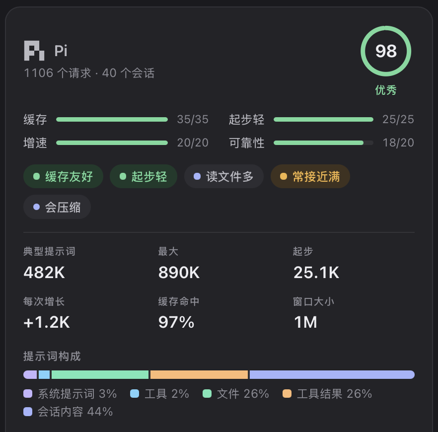

# opencode-slim

**OpenCode 的 TUI，Pi 一样的轻量。**

[English](README.md) · **简体中文**

> 本分支适用于 **OpenCode 1.x**。OpenCode 2 的支持计划放在 `opencode-2` 分支。

## 为什么

OpenCode 的 TUI 更好用，但每个会话起步都很重：你还没输入一个字，冗长通用的系统提示词和一长串内置工具
就随每个请求一起发出去了，而这些工具大多从来不会被调用。[Pi](https://pi.dev) 起步很轻，但它的 TUI
和操作方式让人难以忍受。

这个仓库保留 OpenCode 的 TUI，把其余部分裁剪到接近 Pi 的分量。它只改配置：不 fork、不改二进制，
每项改动都能通过还原一个文件撤销。

## 效果

[Magpie](https://github.com/yetone/magpie) 统计每个请求在对话内容之前固定携带的部分：系统提示词、
工具定义、skills 和记忆文件。同一台机器上的中位数：

| | 起步 | 工具占提示词 |
|---|---|---|
| OpenCode 改前 | 152K | 33% |
| OpenCode 改后 | **31.6K** | **6%** |
| Pi | 25.1K | 2% |

<table>
<tr><th>OpenCode 改前</th><th>OpenCode 改后</th><th>Pi</th></tr>
<tr>
<td></td>
<td></td>
<td></td>
</tr>
</table>

"改前"的数字包含后来改为项目级的 MCP 服务器。在全新安装的 OpenCode 1.19 上，用
[`scripts/measure.sh`](scripts/measure.sh) 和同一个模型测，核心改动把首个请求从 7,094 降到 5,091
tokens（−28%）。在实际环境里，MCP 精简省得最多：单是一个 Atlassian MCP 服务器，每个请求就约占
12,800 tokens。

## 改了什么

| 改动 | 效果 | 依赖 |
|---|---|---|
| 精简的 `build` 和 `plan` 提示词，放在 `~/.config/opencode/agents/` | 用约 25 行替换 OpenCode 冗长的默认提示词 | — |
| 关闭 Glob 和 Grep 工具 | 每个请求少两个工具定义；agent 改用 bash 里的 `rg` 搜索 | [ripgrep](https://github.com/BurntSushi/ripgrep) |
| 精简全局 `AGENTS.md` | 它随每个请求发送；建议控制在 4,000 字符以内 | — |
| 精简 MCP | 每个启用的 MCP 服务器都会发送它的全部工具定义；全局只留每天都用的，其余按项目启用 | — |
| 把 OpenCode 固定在 1.x | 升级不会跳到 OpenCode 2（1.x 插件在 2 上无法运行） | — |

plan agent 保留 OpenCode 的只读权限，只替换提示词。

## 安装

clone 仓库，把执行手册交给你的 agent：

```sh
git clone https://github.com/yangwudong/opencode-slim
```

然后在 OpenCode（或任意 coding agent）里说：

```text
Read opencode-slim/SETUP.md and follow it.
```

agent 会检查版本、测量你当前的配置、询问要应用哪些改动、备份每个要改的文件、验证结果，并报告省下的
tokens。想手动操作的话，照着 [SETUP.md](SETUP.md) 一步步做即可。

## 测量你的配置

```sh
scripts/measure.sh                         # 默认模型和 agent
scripts/measure.sh -m provider/model -a plan
```

它在一个空的临时仓库里发一句很短的提示，输出首个请求的输入 tokens。只有同一个模型的结果之间才能比较，
因为不同模型的分词方式不同。想知道某个 MCP 服务器占多少，就在关掉它的情况下再测一次：

```sh
OPENCODE_CONFIG_CONTENT='{"mcp":{"<name>":{"enabled":false}}}' scripts/measure.sh
```

## 可选插件

以下插件都不是必需的。用 `scripts/measure.sh` 测量，每个插件每次请求增加的 tokens 都不超过约 200。

| 插件 | 作用 |
|---|---|
| [opencode-tps-meter](https://github.com/yangwudong/opencode-tps-meter) | 在 TUI 里显示模型的输出速度（tokens/秒）。 |
| [opencode-bark-notify](https://github.com/yangwudong/opencode-bark-notify) | 通过 Bark 把 agent 的回复、提问和权限请求推送到 iPhone。 |
| [opencode-quota](https://github.com/yangwudong/opencode-quota) | 显示 Copilot、Z.ai、Kimi、OpenCode Go 等的额度和 token 用量，不污染上下文窗口。 |
| [Plannotator](https://github.com/backnotprop/plannotator) | 在实施前审阅、批注 plan agent 的计划。SETUP.md 会装一个向它提交计划的 plan 提示词。 |
| [cc-safety-net](https://github.com/kenryu42/cc-safety-net) | 拦截危险的 shell 命令，比如在项目外 `rm -rf`、`git push --force`。 |
| [opencode-notifier](https://github.com/mohak34/opencode-notifier) | agent 完成或需要权限时，弹桌面通知并播放提示音。 |

前三个适用于 OpenCode 1.x。

## 用 Magpie 测量

[Magpie](https://github.com/yetone/magpie) 让所有 coding agent 的模型都经过同一个本地网关，它的上下文
页面会显示每个 agent 的提示词由哪些部分组成。它的"起步轻"分数，是拿每个请求固定携带的部分和模型的上下文
窗口比：占 5% 及以下满分，占 30% 为零分。在 1M 窗口下 31.6K 是满分；同样的 31.6K 放到 200K 窗口下，
只有一半左右的分。

## 许可证

[MIT](LICENSE)
